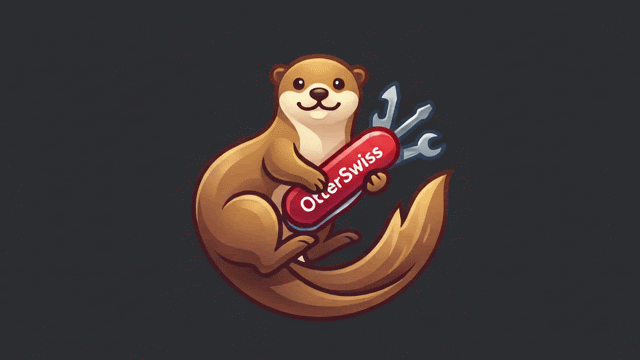

<div align="center">
  
  <h1>OtterSwiss v3.5.1</h1>
  <p><strong>Suite portable de optimización, diagnóstico y utilidades nativas para Windows 10 / 11 (x64)</strong></p>
</div>

---

## ⚡ ¿Qué es OtterSwiss?
**OtterSwiss** es una suite de mantenimiento y optimización para Windows desarrollada íntegramente en **Rust** con interfaz gráfica moderna sin bordes (*frameless*) en **Dioxus 0.7**, con **Auto-Actualizador integrado conectado a GitHub Releases**.

## 🛠️ Compilación
```powershell
cargo build --release